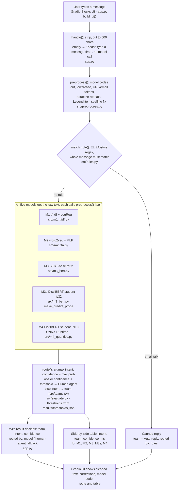
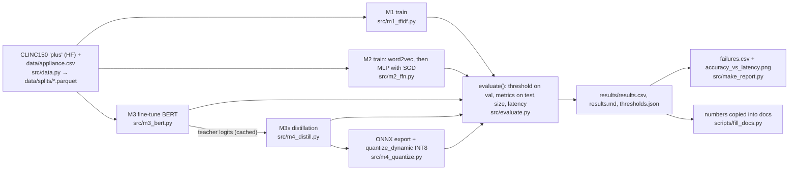

# Architecture

Everything runs on CPU at inference time (torch and ONNX Runtime set to 4 threads). Each box names the file that does the work.

## App: one message (`python app.py`)

`preprocess()` is called in `handle()` only to show the cleaned text, corrections and model code in the UI; the rules then look at the original text. Model weights load once at startup (`load_models()` in app.py); if `models/m4_int8.onnx` is missing they are downloaded from the HF Hub repo in `config.py`.

## Training and evaluation (`python train_all.py`)

The small-talk rules are not part of the evaluation: the models are measured alone so the comparison is fair.
