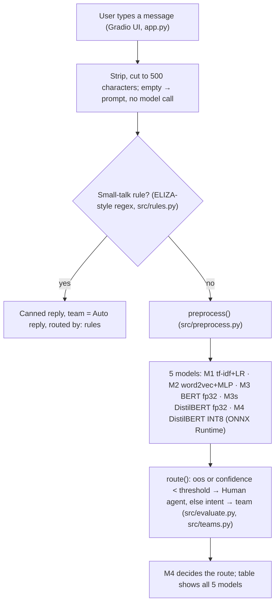

# Presentation brief – Customer Support Ticket Router (SWE015, Use Case 2)

This file holds everything needed to build the presentation slides and the demo video. Paste the whole file into a Claude chat and ask it to build the slides. Also attach `results/accuracy_vs_latency.png` and a screenshot of the running app.

The tables between `<!-- …-START -->` and `<!-- …-END -->` are copied from the result files by `scripts/fill_docs.py`. Do not edit them by hand.

---

## 1. Instructions for the slide assistant

You are helping a student build the slides for a university homework presentation. Follow these rules:

1. **Use only the numbers in this file.** Copy every metric exactly from the tables in sections 6 and 9. Never round by hand, estimate, average or invent a number. If a number you want is not here, leave a placeholder like `[NUMBER?]` and say so. A wrong or invented number gives the homework grade 0.
2. **Structure:** 8–12 slides in three parts, in this order: **Introduction → Development → Results**.
3. **Mandatory content** (the grading checks each one):
   - First slide: student name, student number, scenario (Use Case 2: Customer Support Ticket Router), GitHub repo link, video link.
   - A **technique map** slide showing at least one technique from each area A, B, C and D (section 5).
   - The **architecture diagram** (section 4). It must match the code, so do not add boxes that are not described there.
   - The **results table**: task metric, size (MB) and latency (ms) for every model, plus the hardware line (section 6).
   - At least one **failure example** in the Results part (section 7).
   - An **AI-usage slide** (section 10). The student will rewrite it in their own words.
   - **Data sources** with citation (section 3).
4. Keep slides short: a title and 3–5 bullets, or one table or one diagram. Put longer explanations in the speaker notes.
5. Placeholders the student fills in: `[NAME]`, `[STUDENT NUMBER]`, `[VIDEO LINK]`.

---

## 2. Project in one paragraph

A customer writes a support message in English. The system finds the **intent** of the message (e.g. "check balance", "dishwasher not draining") and sends it to the right **team** (e.g. Banking & Cards, Technical Service, Warranty). When the message is out of scope, or the model is not confident enough, it goes to a **Human agent** instead of a wrong team. Five models are compared on the same held-out test set, from a classical baseline to a distilled, INT8-quantized Transformer. A Gradio web app lets you type a new message; the quantized model (M4) decides the route, and all five models are shown side by side.

- GitHub repo: https://github.com/kintpon/project-LLM-swe015-ticket-router
- Trained weights (public): https://huggingface.co/kintpon/swe015-ticket-router
- Run it: `python app.py`, then open http://127.0.0.1:7860 (setup steps in the README)

---

## 3. Data

- **CLINC150, `plus` config:** 150 intents + `oos` (out of scope), official train/validation/test splits. License CC BY 3.0.
  Citation: Stefan Larson, Anish Mahendran, Joseph J. Peper, Christopher Clarke, Andrew Lee, Parker Hill, Jonathan K. Kummerfeld, Kevin Leach, Michael A. Laurenzano, Lingjia Tang, Jason Mars. *An Evaluation Dataset for Intent Classification and Out-of-Scope Prediction.* EMNLP-IJCNLP 2019. Dataset: https://huggingface.co/datasets/clinc/clinc_oos
- **Appliance support rows** (`data/appliance.csv`): 5 new intents (`not_draining`, `not_heating`, `error_code`, `spare_part_order`, `warranty_claim`), 20 short English messages each, some with model codes (e.g. `DW-6534`) and misspelled product names. They were **written with AI assistance**. Split per intent: 14 train / 3 val / 3 test.
- Train rows whose text also appears in val or test were removed; val and test stay official.
- Each intent maps to a team by CLINC domain. The appliance intents go to Technical Service, Spare Parts or Warranty, `oos` goes to Human agent, and small talk goes to Auto reply.

<!-- DATA-START -->
| Split | CLINC rows | Appliance rows | Total |
|---|---|---|---|
| train | 15245 | 70 | 15315 |
| val | 3100 | 15 | 3115 |
| test | 5500 | 15 | 5515 |

Classes (intents incl. `oos`): 156. Teams: 10.
<!-- DATA-END -->

**Preprocessing**, the same for every model in training, evaluation and the app:
1. Extract model codes such as `DW-6534` and remove them from the text.
2. Lowercase.
3. Replace URLs and emails with placeholder tokens.
4. Squeeze repeated letters (`soooo` → `soo`).
5. Spelling correction with our own Levenshtein distance towards product words (`dishwaher` → `dishwasher`). Only unknown words of 5+ letters are corrected, so real words like "over" never become "oven".
6. Normalise whitespace.

---

## 4. Architecture (what happens to one message in the app)

- Everything runs on CPU at inference time, with 4 threads.
- Thresholds are read from `results/thresholds.json`. Weights load once at startup and are downloaded from Hugging Face if missing.
- The small-talk rules are used **only in the app**. The evaluation measures the models alone, so the comparison stays fair.
- The full diagram with file names on every box is in `docs/architecture.md`.

---

## 5. Technique map

| Component | Area | Technique | File |
|---|---|---|---|
| Text cleaning | B – Classical NLP | regex: model-code extraction, URL/email tokens, repeated letters | src/preprocess.py |
| Spelling correction | B – Classical NLP | own Levenshtein distance (dynamic programming) | src/preprocess.py |
| Small-talk replies | B – Classical NLP | ELIZA-style regex rules (app only) | src/rules.py |
| M1 | B – Classical NLP | tf-idf (word 1–2 grams) + logistic regression | src/m1_tfidf.py |
| M2 | A – Neural network | word2vec mean vector → PyTorch MLP, hand-written SGD training loop, early stopping | src/m2_ffn.py |
| M3 | C – Transformer | fine-tuned bert-base-uncased (teacher) | src/m3_bert.py |
| M3s | D – Efficient model | knowledge distillation into DistilBERT (student) | src/m4_distill.py |
| M4 | D – Efficient model | ONNX export + ONNX Runtime dynamic INT8 quantization | src/m4_quantize.py |
| Routing | – | confidence threshold tuned on validation; oos / low confidence → Human agent | src/evaluate.py |
| Demo | – | Gradio Blocks app | app.py |

**How each model was trained** (seed 42; all run in order by `python train_all.py`; M3 and M3s trained on the student's own laptop GPU):
- **M1:** tf-idf on word 1–2 grams + logistic regression.
- **M2:** word2vec (dimension 100) trained on our train texts. A message becomes the mean of its word vectors and goes through an MLP 100 → 256 → classes (ReLU, dropout 0.2). The training loop is written by hand: SGD with momentum, `loss.backward()`, early stopping on validation accuracy.
- **M3:** `bert-base-uncased` (~110M parameters) fine-tuned: max length 32, lr 3e-5, batch 32, 3 epochs, best epoch by validation accuracy.
- **M3s:** `distilbert-base-uncased` (~67M parameters) learns from M3 with knowledge distillation: loss = 0.5·CE(labels) + 0.5·T²·KL(teacher/T ‖ student/T), T = 2, 5 epochs.
- **M4:** M3s exported to ONNX, then `quantize_dynamic` with INT8 weights. It runs with ONNX Runtime only, no PyTorch model needed.

The ladder for the slides is M1 → M2 → M3 → M4. M3s is the extra row that separates the two costs: M3 → M3s shows what distillation costs, and M3s → M4 shows what quantization costs.

---

## 6. Results (test split, after routing)

How to read the table:
- **In-scope acc:** share of in-scope messages that get the correct intent. A message sent to the Human agent counts as wrong.
- **OOS recall:** share of out-of-scope messages that are sent to the Human agent.
- **Threshold:** each model's confidence threshold, tuned on validation only, maximising (in-scope acc + oos recall) / 2.
- **Size:** all files the model needs at inference, tokenizer files excluded.
- **Latency:** one message at a time on CPU, preprocess → route, mean and p95 over 200 test messages after 10 warm-up calls.

<!-- RESULTS-START -->
| Model | In-scope acc | OOS recall | Appliance acc (15 rows) | Threshold | Size (MB) | Latency mean (ms) | Latency p95 (ms) |
|---|---|---|---|---|---|---|---|
| M1 tf-idf + LogReg | 0.7980 | 0.9070 | 0.0000 | 0.45 | 40.9 | 0.43 | 0.61 |
| M2 word2vec + MLP | 0.6726 | 0.8770 | 0.1333 | 0.90 | 2.6 | 0.14 | 0.36 |
| M3 BERT-base (fp32) | 0.9094 | 0.8720 | 0.0000 | 0.25 | 438.4 | 61.43 | 70.90 |
| M3s DistilBERT student (fp32) | 0.9079 | 0.9100 | 0.0000 | 0.65 | 268.3 | 31.76 | 34.29 |
| M4 DistilBERT student INT8 (ONNX Runtime) | 0.8930 | 0.9320 | 0.0000 | 0.65 | 67.5 | 12.01 | 13.05 |

Hardware: 12th Gen Intel(R) Core(TM) i7-12700H (20 logical cores, 31.8 GB RAM), Windows-11-10.0.26200-SP0, Python 3.12.13, torch 2.11.0+cu128, onnxruntime 1.32.0; latency on CPU, 4 threads

Notes: size = all files needed at inference, tokenizer files excluded. Latency = one message at a time, preprocess -> route, 10 warm-up calls then 200 test messages (same for all models). Metrics are measured on the models alone (small-talk rules not applied). Appliance accuracy covers only 15 test rows (3 per appliance intent), so treat it with caution. Reproducibility: the M3, M3s and M4 rows come from a training run made before a seeding fix (the new classification head was created before the seed was set; see worklog_001.md), and GPU training is not bit-exact, so re-running train_all.py gives different numbers for these rows.
<!-- RESULTS-END -->

Plot: `results/accuracy_vs_latency.png`, latency (log scale) against in-scope accuracy, one point per model. Attach it to the chat.

---

## 7. Failure examples (M4)

Three examples to show, with a one-line reason each:

1. *"where can i buy a replacement filter for my dishwasher"*: true `spare_part_order`, predicted `oos`. The appliance intents have only 14 training rows each, so the model has seen few ways to ask for a part.
2. *"give me an eta on when i will arrive at my destination"*: true `distance`, predicted `flight_status`. "eta" and "arrive" are typical flight words, and the two intents overlap in meaning.
3. *"when will i get to orlando"*: true `distance`, predicted `distance`, but the confidence is below M4's threshold. The message goes to a human agent and counts as wrong. Half of the 10 sampled failures are of this kind: a safe fallback, not a wrong team.

All 10 sampled failures are in `results/failures.csv`.

---

## 8. Where each model wins and loses (read the numbers from section 6)

- **M1 tf-idf + LogReg:** a strong, cheap baseline that needs no GPU. It fails on paraphrases that share no words with the training data.
- **M2 word2vec + MLP:** the smallest and fastest model. Averaging the word vectors throws away word order, and word2vec saw only our training texts, so its accuracy is the lowest.
- **M3 BERT:** the best in-scope accuracy, but the largest and slowest model on CPU.
- **M3s DistilBERT student:** almost the teacher's accuracy at about half the latency and with a smaller file. Distillation alone costs little.
- **M4 INT8:** the smallest and fastest Transformer, with a small accuracy drop against M3s. This is the model the app uses.

---

## 9. Honest limitations (good for the Results / conclusion slide)

- **Appliance rows:** there are only 15 test rows (3 per intent). The Transformers give these rows a confidence below their threshold and send them to the Human agent, so their appliance accuracy is 0 (column "Appliance acc" in section 6). This is reported as it is. The cause: 70 appliance training rows against more than 15,000 CLINC rows.
- **English only:** Turkish letters such as "ı" are removed in preprocessing. A Turkish message goes to the Human agent; the app does not crash.
- **Reproducibility:** the M3, M3s and M4 rows come from a training run made before a seeding fix, and GPU training is not bit-exact, so re-training gives different numbers. The note under the results table says this.
- The model-code regex also catches flight numbers such as "dl123". This is harmless for routing, but the app shows them as a "model code".

---

## 10. AI usage (draft – the student must rewrite this in their own words)

- I used **Claude Code** (Anthropic) as a coding assistant. It worked from a written specification (`CLAUDE.md`) that I prepared, which fixed the models, data, metrics and work phases in advance.
- The assistant wrote most of the code, tests and documents. I answered every design question it asked (recorded in `docs/decisions.md`), reviewed each phase, and ran and recorded the demo myself.
- The 100 appliance messages were written with AI assistance.
- Every number in the slides is produced by a script and copied into the documents by `scripts/fill_docs.py`. None was typed by hand.
- What I checked myself: `[STUDENT FILLS IN]`

---

## 11. Suggested slide outline (10 slides)

| # | Part | Slide | Content |
|---|---|---|---|
| 1 | Intro | Title | Project name, [NAME], [STUDENT NUMBER], Use Case 2, repo link, [VIDEO LINK] |
| 2 | Intro | Problem | Support messages reach the wrong team; goal: automatic routing plus a safe human fallback |
| 3 | Intro | Data | CLINC150 plus + 100 appliance rows, split table (section 3), citation |
| 4 | Development | Architecture | Diagram from section 4 |
| 5 | Development | Technique map | Table from section 5 (A, B, C, D) |
| 6 | Development | Model ladder | M1 → M2 → M3 → M3s → M4, how each was trained (one line each) |
| 7 | Development | Demo | App screenshot: typo + model code example, side-by-side table |
| 8 | Results | Results table | Table + hardware line from section 6; plot |
| 9 | Results | Failures & limitations | 1–3 examples from section 7, appliance-rows limitation |
| 10 | Results | Conclusion + AI usage | What each step cost (sections 8, 9) + AI-usage bullets (section 10) |

---

## 12. Demo video script (max 2:00, with voice)

The video must show the live app, the architecture and the results.

| Time | Screen | What to say |
|---|---|---|
| 0:00–0:15 | Title slide | Name, scenario: a router that sends support messages to the right team, or to a human when unsure. |
| 0:15–0:35 | Architecture slide | Rules for small talk, then preprocessing (model codes, spelling fix), then the quantized DistilBERT decides; low confidence goes to a human agent. |
| 0:35–1:20 | Live app | Click the 4 examples: (1) savings balance → Banking & Cards; (2) "my dishwaher DW-6534 …" → spelling fix and model code shown, low confidence → Human agent; (3) football question → out of scope → Human agent; (4) "hello there" → answered by rules. Point at the side-by-side table. |
| 1:20–1:50 | Results slide | Read the in-scope accuracy, size and latency of M3 and M4 from the table: what distillation and quantization saved, and what they cost. |
| 1:50–2:00 | Conclusion | One limitation (appliance rows) and the repo link. |

Upload the video (YouTube unlisted or Google Drive). Then open both the video link and the repo link in a private browser window to check they open.

---

## 13. Questions the instructor may ask

- **Why a confidence threshold?** A wrong team is worse than a human agent. The threshold is tuned on validation only, never on test.
- **What is knowledge distillation?** The student learns from the teacher's softened probabilities (temperature T = 2), not only from the hard labels. The KL term pulls the student's distribution towards the teacher's.
- **Why ONNX Runtime and not PyTorch quantization?** PyTorch has deprecated its dynamic quantization API. ONNX Runtime INT8 runs without PyTorch and is on the course's technique list.
- **Why is M4 smaller and faster?** Its weights are stored as 8-bit integers instead of 32-bit floats, and the student has fewer layers than BERT.
- **Is the test set leaked anywhere?** No. Training, early stopping, threshold tuning and the vocabularies use only train and validation, and a test checks that no text appears in both train and test.
- **Why does the app need rules if the models know small talk?** The rules are fast, fixed and explainable for greetings and thanks. They run only in the app, so the model comparison stays fair.
